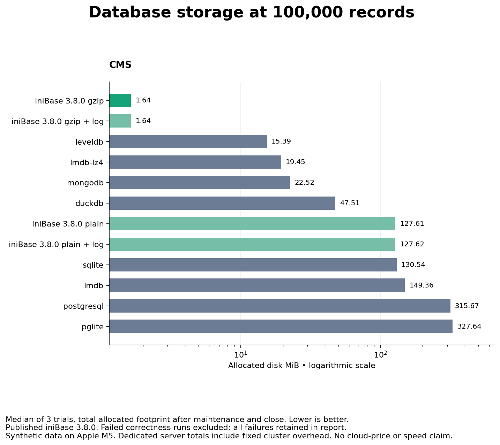

# Inicontent CMS

[](https://www.npmjs.org/package/inicontent) [](./LICENSE) [](https://github.com/inicontent/inicontent/pulse) [](https://github.com/inicontent/inicontent)

> **License:** Inicontent CMS is open source under the [Apache License 2.0](./LICENSE). This repository contains the client layer only — the Inicontent backend API (`inicontent/api`) is proprietary.

## Powered by Inibase

The Inicontent backend is powered by [Inibase](https://github.com/inicontent/inibase), a file-based TypeScript database with column selection, built-in caching, and optional gzip compression.

In the **100,000-record CMS benchmark**, published **Inibase 3.8.0 with gzip and `log: true`** used **1.64 MiB of allocated disk** after bulk loading — **89.3% less than LevelDB** and **98.7% less than SQLite**. Five committed updates took **175 ms**, versus **5,174 ms** with the default gzip update path. Reading two selected columns took **64 ms** before updates.

[](https://github.com/inicontent/benchmarks/blob/11123a511e1c5dc2dce0b80f113ab1f65c02093d/results/large-cms/REPORT.md)

*Source: [inicontent/benchmarks](https://github.com/inicontent/benchmarks/blob/11123a511e1c5dc2dce0b80f113ab1f65c02093d/results/large-cms/REPORT.md), medians of three trials on Apple M5 with repetitive synthetic CMS content, full durability, and query caching disabled. Storage is measured before updates; reads are cache-affected. Logging is opt-in, restricts transactions and schema changes, and defers work to compaction that can increase delete costs. Indexed competitors remain faster for key lookups.*

*These are standalone Inibase 3.8.0 measurements, not browser memory or end-to-end CMS/API benchmarks. The results do not establish which engine version or logging configuration a deployed CMS uses.*

[Explore the full results](https://github.com/inicontent/benchmarks/blob/11123a511e1c5dc2dce0b80f113ab1f65c02093d/results/large-cms/REPORT.md) · [Read the methodology](https://github.com/inicontent/benchmarks/blob/11123a511e1c5dc2dce0b80f113ab1f65c02093d/METHODOLOGY.md)

## Introduction

Inicontent CMS is a content management system built using [Nuxt](https://github.com/nuxt/nuxt) as its framework. It leverages modern tools such as:  
- [Naive UI](https://github.com/tusen-ai/naive-ui) for a sleek component library.  
- [Tabler Icons](https://github.com/tabler/tabler-icons) for intuitive and attractive icons.  
- [Tiptap](https://github.com/ueberdosis/tiptap) for a powerful Rich Text Editor.

## Features

- **Multi-database admin** - manage one or many databases from a single `/admin` interface.
- **Rich text editing** via [Tiptap](https://github.com/ueberdosis/tiptap).
- **Sleek UI** built with [Naive UI](https://github.com/tusen-ai/naive-ui) and [Tabler Icons](https://github.com/tabler/tabler-icons).
- **PWA-ready** out of the box.
- **Drop-in as a Nuxt Layer**, or clone and customize directly.

### Custom blocks

Block types don't have to ship with the CMS. Declare one in
`app/components/Block/customBlocks.ts` — a config `schema`, a
[Liquid](https://liquidjs.com) template, and optional CSS — and it appears in the
builder's block picker, the design picker, the config editor, and page rendering,
with no component to write and no registry to edit.

Templates can read their own config fields (`{{ heading }}`), the row a dynamic
page matched (`{{ item.column }}`), and loop over table rows (``).
Output is HTML-escaped unless you pipe through `| raw`.

See [AGENTS.md](AGENTS.md#custom-blocks-no-component-needed) for the full
contract.

## Ecosystem

- **[`inicontent/starter`](https://github.com/inicontent/starter)** — the minimal layer app to
  build on: a starting point with routing and the project wiring already done.
- **[`@inicontent/mcp`](https://github.com/inicontent/mcp)** — the MCP server that connects code
  agents (ChatGPT, Claude, Cursor, OpenCode, …) to a database: REST tools, context resources
  (the query language, table schemas and flows, authentication, custom-route registration), and
  starter scaffolding. This replaced the in-app AI assistant and chatbot, and is where the
  AI-agent context now lives.
- **`inicontent/api (private)`** — the server behind
  `https://api.inicontent.com/`: REST CRUD per table, authentication, assets.

## REST API & authentication (short version)

Every database gets a public REST API at `https://api.inicontent.com/{databaseSlug}`:

- `PUT {db}/auth/signin` with `{ "username": ..., "password": ... }` → returns a `sessionID`;
  pass it on every request as the `{db}_sid` query param.
- Table data: `GET/POST/PUT/DELETE {db}/{table}` — list pagination/projection live in the
  Inison-stringified `options` query param and filters in `where`.
- Structure: `GET/POST/PUT/DELETE inicontent/databases/{db}[/{table}]` for metadata, schemas,
  flows (`onRequest`/`onResponse`), and table CRUD.
- AI access goes through the `@inicontent/mcp` server (there are no in-app `/ai` endpoints): its
  `inicontent_*` tools wrap the endpoints above and scaffold `inicontent/starter` for custom code.

For the full reference — query language, schema field types, flows, routing —
connect a client to the [`@inicontent/mcp`](https://github.com/inicontent/mcp)
server, which serves it as context resources.

## Usage

There are two ways to use this project:

### 1. Recommended Method: Install from npm and Add as a Nuxt Layer

The easiest way to integrate Inicontent CMS is to install it from npm and use it as a Nuxt Layer.

**Steps:**

1. Install the package:
   ```bash
   npm install inicontent
   ```
   (or `pnpm add inicontent`, `yarn add inicontent`, `bun add inicontent`)
2. Add it as a layer in your `nuxt.config` file:
   ```javascript
   // nuxt.config.ts
   export default defineNuxtConfig({
     extends: ["inicontent"]
   });
   ```
3. Remove your existing `app.vue` file to avoid conflicts.
4. To override specific admin routes, create corresponding files in the `pages` directory. These will automatically override the default routes provided by the CMS.

**Database Configuration:**
- By default, the CMS is a multi-database manager.
  - When no `database` is set in `.env`, the admin interface (`/admin`) will display all available databases. Users can then navigate to a specific database's admin panel at `/admin/<dbName>`.
  - If a `database` is specified in `.env`, the `/admin` route will directly display the tables for the specified database, removing the need to include the database name in the path.

```sh
# .env
database=DATABASE_SLUG
```

This method keeps your project clean and makes updates to the CMS easy: you stay on the `inicontent` version pinned in your `package.json` and upgrade intentionally with `npm update inicontent`.

### 2. Advanced Method: Clone and Edit the Repository

If you need extensive customization, clone the repository and modify it directly.
```bash
git clone https://github.com/inicontent/inicontent.git
cd inicontent
pnpm install
```

## Environment Variables

| Variable   | Required | Default                       | Description                                    |
|------------|----------|--------------------------------|------------------------------------------------|
| `database` | No       | `inicontent`                  | Database slug the admin panel targets directly. |
| `apiBase`  | No       | `https://api.inicontent.com/` | Base URL for the Inicontent API.                |
| `idOne`    | No       | (built-in default)            | Public identifier used by the API client.       |

Copy these into a local `.env` file as needed; none are required to start the dev server.

## Setup

Install the dependencies to get started (any package manager works — npm, pnpm, yarn, or bun):  

```bash
npm install
```

## Development

Start the development server at [http://localhost:3434](http://localhost:3434):

```bash
npm run dev
```

## Production

Build the application for production:

```bash
npm run build
```

Preview the production build locally:

```bash
npm run preview
```

## Linting

This project uses [Biome](https://biomejs.dev/) for linting and formatting:

```bash
pnpm lint    # check
pnpm format  # check and write
```

## Contributing

Contributions are welcome. See [CONTRIBUTING.md](CONTRIBUTING.md) for setup, branch/commit conventions, and the PR process.